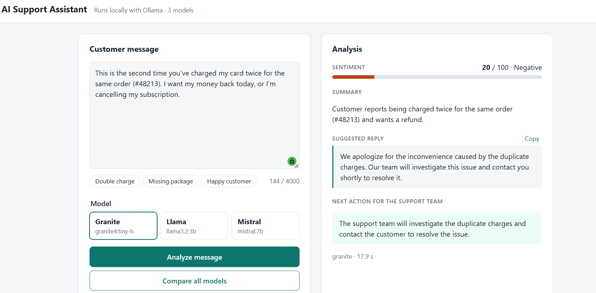
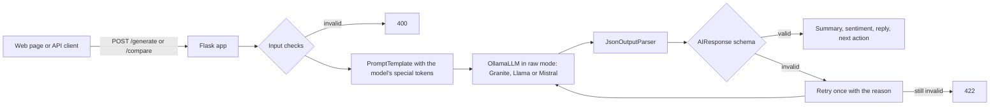
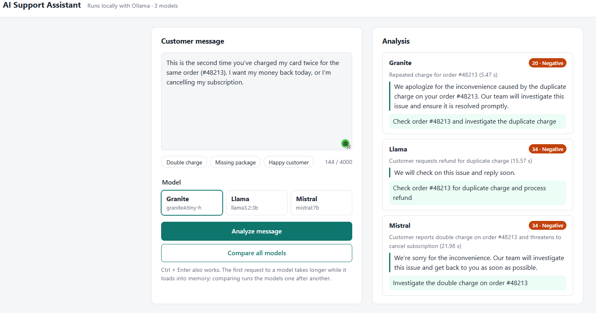

# AI Support Assistant


> Based on IBM's **"Build Your First GenAI Application the Right Way"** lab
> (*Hands-on with GenAI: Choosing the Right Model for Your Application*, IBM Skills Network on Coursera),
> rebuilt to run **fully locally and free** with IBM Granite, Meta Llama and Mistral via Ollama,
> and extended with input validation, a model comparison view and a measured scorecard.

A support agent pastes a customer message and gets back, in a few seconds:

- a **summary** of the message,
- a **sentiment score** (0–100),
- a **suggested reply**, written to avoid promises the company hasn't approved,
- the **next action** for the support team, with the order or tracking number kept.

The same message can be sent to all three models side by side, and a scorecard script measures
which model does the job best.



## What this project covers

Every lab section has its own script, and the lab's tasks are solved with my own support messages.

| Lab section | Where it's implemented |
|---|---|
| Environment setup | `scripts/00_check_setup.py`, `src/support_assistant/config.py`, `llm.py` |
| First call to an LLM (greedy decoding, token limit) | `scripts/01_first_call.py` |
| Trying other LLMs and how to choose one | `scripts/02_unformatted_prompts.py` |
| Special tokens and prompt formatting (task: try them on each model) | `scripts/03_prompt_formatting.py`, `src/support_assistant/templates.py` |
| LangChain integration and sanity check (`template \| model`) | `scripts/04_all_models.py`, `src/support_assistant/model.py` |
| JSON output with Pydantic and `JsonOutputParser` (task: add a next step for the support rep) | `scripts/05_structured_output.py`, `src/support_assistant/schemas.py` |
| Flask app with `/generate`, model choice, error handling and timing | `app.py`, `templates/`, `static/` |
| **Extension:** compare all models on one message | `POST /compare` in `app.py`, "Compare all models" on the page |
| **Extension:** scorecard over 12 labelled messages, and a prompt fix measured before and after | `scripts/06_scorecard.py`, `src/support_assistant/evaluation.py`, `data/support_messages.csv` |
| Automated tests and CI | `tests/` (67 tests), `.github/workflows/tests.yml` |

Each script starts with a short header: its **aim**, **what you'll see** and **what to notice**.

## What's different from the original lab

**Changed to run locally (no cloud account, no cost)**
- IBM watsonx.ai → **Ollama**. The three model families from the lab, in sizes that fit a 6 GB GPU:

  | Lab (watsonx.ai) | Here (Ollama) |
  |---|---|
  | `ibm/granite-4-h-small` | `granite4:tiny-h` |
  | `meta-llama/llama-4-maverick-17b-128e-instruct-fp8` | `llama3.2:3b` |
  | `mistralai/mistral-small-3-1-24b-instruct-2503` | `mistral:7b` |

- The lab's price per token is replaced by what costs money locally: **time**. Scripts report output
  tokens, seconds per answer and tokens per second, with model loading time measured separately.
- `pip` and a virtual environment → `uv` with a lock file. Credentials and project IDs → an optional `.env`.

**Fixes to the lab's code**
- **Correct special tokens.** The lab's Llama template uses Llama 4 tokens (`<|header_start|>`, `<|eot|>`)
  and its Granite template uses `<|system|>`/`<|user|>`, which isn't Granite 4's format. The templates
  here are copied from `ollama show --template`, and script 03 proves them: hand-formatted prompts give
  exactly the same answers as Ollama's own chat formatting, for every model.
- **No double formatting.** The lab sends hand-written special tokens to `ChatWatsonx`, a chat model that
  wraps the prompt in its own template again. Here the prompt goes to a text-completion model in raw mode
  (`OllamaLLM(...).bind(raw=True)`), so the model sees exactly what was written. No start token is written
  by hand either, since the tokenizer adds it.
- **The output is actually validated.** The lab says `JsonOutputParser` validates the answer against
  `AIResponse`, but it only parses JSON: it accepted `{"summary": 5, "sentiment": 250}`, and it turned a
  truncated answer into an empty `{}` without an error. Pydantic now checks every field and the 0–100 range.
- **A retry that can work.** With greedy decoding, asking again gives the same broken answer. The retry
  tells the model what was wrong with its first answer.
- **Clear HTTP errors.** The lab returns 500 with the raw error text for everything. Here: 400 for bad input
  (checked before any model is called), 422 for an unusable answer, 503 when Ollama is down or a model isn't
  downloaded (with the `ollama pull` command), and 500 with the details logged on the server, not sent to
  the browser. The app runs without Flask's debug mode and only on `127.0.0.1`.
- **Safe output on the page.** Model and customer text are inserted with `textContent`, never `innerHTML`.

**Extensions**
- **`next_action` keeps actions out of the reply.** Before it existed, models promised replacements or
  claimed they had "reported the issue" to the customer. Now the reply stays neutral and the step for the
  support team goes in its own field.
- **Compare all models** on one message, side by side, in the app and through `POST /compare`.
- **Scorecard:** 12 support messages labelled by hand, scored per model on usable JSON, sentiment, rule
  breaks in the reply, IDs kept in the next action, and speed. Used to measure a prompt change (below).

## How it works



`src/support_assistant/` holds the logic once. The scripts, the web app and the tests all reuse it.

## Project structure

```
ai-support-assistant/
├── src/support_assistant/
│   ├── config.py        # model names, Ollama URL, generation settings (replaces watsonx config)
│   ├── llm.py           # Ollama calls with timings: raw text and chat
│   ├── templates.py     # each model's special tokens
│   ├── model.py         # LangChain chains, support prompt, JSON output with retry
│   ├── schemas.py       # AIResponse: the answer's fields and checks
│   └── evaluation.py    # scorecard: sentiment buckets, rule checks, summary tables
├── scripts/             # one script per lab section (00–05) and the scorecard (06)
├── data/support_messages.csv   # 12 labelled support messages
├── templates/, static/  # the web page (HTML, CSS, JavaScript, no external libraries)
├── tests/               # 67 tests with fake models, no Ollama needed
├── app.py               # Flask app: GET /, POST /generate, POST /compare
└── pyproject.toml       # dependencies (managed with uv)
```

## Quick start

**Requirements:** [Ollama](https://ollama.com) and [uv](https://docs.astral.sh/uv/).
Tested on Windows 11 with a GTX 1660 Ti (6 GB) and 16 GB RAM.

```bash
# 1. Download the models (about 11 GB in total, once)
ollama pull granite4:tiny-h
ollama pull llama3.2:3b
ollama pull mistral:7b

# 2. Get the code and install dependencies
git clone https://github.com/hlmhlr/ai-support-assistant.git
cd ai-support-assistant
uv sync

# 3. Optional: copy the settings file to change models
cp .env.example .env        # Windows PowerShell: copy .env.example .env

# 4. Check that Ollama and the models work
uv run python scripts/00_check_setup.py
```

### Run the web app

```bash
uv run python app.py
```

Open http://127.0.0.1:5000, pick a sample message, then **Analyze message** or **Compare all models**.
The first request to each model is slower while it loads into memory.



### Use the API

```bash
curl -X POST http://127.0.0.1:5000/generate -H "Content-Type: application/json" \
     -d '{"message": "I was charged twice for order #48213.", "model": "granite"}'
```

Example response (shortened):

```json
{
  "summary": "...", "sentiment": 18, "response": "...", "next_action": "...",
  "model": "granite", "duration": 5.2
}
```

`POST /compare` takes only `{"message": "..."}` and returns `{"results": [...]}`, one entry per model,
each with its own `status`.

| Status | Meaning |
|---|---|
| 200 | Answer with all four fields |
| 400 | Missing or invalid message or model, or a message over 4,000 characters |
| 422 | The model's answer was unusable, even after one retry (`problem` says why) |
| 503 | Ollama isn't running, or the model isn't downloaded |
| 500 | Unexpected error (details in the server log) |

### Run the lab scripts and the scorecard

```bash
uv run python scripts/03_prompt_formatting.py
uv run python scripts/05_structured_output.py
uv run python scripts/06_scorecard.py --label before
uv run python scripts/06_scorecard.py --label quick --models granite --limit 3
```

Scorecard results are saved to `outputs/scorecard_<label>.md` and `.csv`.

### Tests

```bash
uv run pytest
```

## Results

All results are from a GTX 1660 Ti (6 GB) with greedy decoding, so each run is repeatable.

**Special tokens matter** (script 03, output tokens for "What is the capital of Canada?"):

| Model | Without special tokens | With the model's tokens | Hand-formatted = Ollama chat? |
|---|---|---|---|
| Granite | 5 | 4 | yes |
| Llama | 100 (hit the limit, kept writing questions and answers) | 4 | yes |
| Mistral | 29 | 23 | yes |

Without its tokens, a model can't tell where the question ends, so it continues the text like a document.
Llama went from 100 tokens (the limit) to 4.

**Choosing the model: scorecard on 12 labelled support messages** (script 06), before and after a
prompt change. The change added rules against asking for details the customer already gave, stating
product facts the assistant doesn't have, and sending the customer to "customer support"; required order
and tracking numbers in `next_action`; and gave the sentiment field ranges (0–34 negative, 35–65 neutral,
66–100 positive).

| Model | Usable JSON | Sentiment matches label | Replies with a rule break | IDs kept in next action | Seconds per answer |
|---|---|---|---|---|---|
| Granite | 100% → 100% | 83% → 75% | 4 → 2 of 12 | 40% → **80%** | 5.6 → 5.5 |
| Llama | 100% → 100% | 25% → **50%** | 2 → 1 of 12 | 20% → **100%** | 4.4 → 4.3 |
| Mistral | 100% → 100% | 42% → 42% | 2 → 1 of 12 | 40% → **80%** | 8.9 → 8.9 |

What the numbers say:
- **The prompt change helped where it was specific.** Keeping order and tracking numbers improved for every
  model, and rule breaks halved (8 → 4): "asks for given details" disappeared and "states product fact"
  fell from 6 to 2.
- **It cost no time.** The longer prompt didn't change the seconds per answer.
- **The retry was never needed.** Every answer was valid JSON on the first try (format instructions plus
  greedy decoding). The retry stays as a safety net.
- **Granite is the best default for this task:** the most accurate sentiment, consistently usable output and
  mid-range speed. Llama is fastest but its sentiment is unreliable. Mistral is the slowest and leads on
  nothing here.

**Looking at individual messages** (the per-message CSV that script 06 writes) shows what the averages hide:
- **The models copied the numbers from the prompt.** After the sentiment ranges were added, 10 of 12 Mistral
  scores and 7 of 12 Llama scores were exactly 34, 35, 65 or 66, the range limits written in the field
  description (none were before). So Llama's better sentiment is partly scores landing one point on the right
  side of a limit, and some misses are one point on the wrong side (Llama scored the missing package 35,
  "neutral", where 34 would have been "negative"). Describing the scale with examples instead of limits
  ("an angry complaint is around 10, a question around 50, praise around 90") is the next thing to try.
- **Each model has a habit.** Granite scored 8 of its 10 non-positive messages exactly 20, including neutral
  requests like a size exchange or a cancellation. Llama scored four of the five neutral messages 0, in both runs.
- **Granite's sentiment drop is one message:** the Sunday delivery question went from 60 (neutral) to 20.
- **Both promises after the change are on the same message,** the late refund ("I still haven't received my
  refund"): Granite's reply matched the promise check in both runs, and Llama's did after the change. When the
  customer is asking about a refund, "don't promise refunds" in the prompt isn't enough; that's why the
  scorecard checks for it.
- **Mistral's first message was slower in both runs** (13–14 s against about 8.5 s for the rest), most likely
  because Ollama reuses the already-processed system prompt for the following messages, which all share it.

## Limitations

- **12 messages is a small test set.** One message moves a percentage by about 8 points, and scores sitting
  on a range limit can flip with a one-point change. The sentiment labels are my own judgment; the
  "broken mug" message mixes praise and a complaint and is labelled neutral.
- **The rule checks are text patterns,** not a full review. They catch the phrasings seen during the build
  ("I've reported", "we will send a replacement", `[Customer]`), but a reply can break a rule in other words.
- **The assistant has no product or order data.** It can't know delivery days or discount rules, so it's told
  not to state them. Answering those questions properly would need retrieval (RAG) over company documents.
- **One model at a time on a 6 GB GPU.** Ollama swaps models, so the first request to each one takes 10–15 s,
  and `/compare` runs the models one after another.
- **Local single-user app.** No login, rate limiting or production server; Flask's built-in server is for development.

## What I learned

- **Each model family has its own chat format**, and a prompt without the right special tokens is just text to
  continue. Checking the real template (`ollama show --template`) caught mistakes copied from a tutorial.
- **Chat models and text-completion models are called differently.** Sending hand-formatted tokens to a chat
  model formats the prompt twice; raw mode sends it as written.
- **Parsing is not validation.** A JSON parser can return wrong types, missing fields or even `{}` from a
  truncated answer without complaining. A Pydantic schema makes the rules explicit and testable.
- **Greedy decoding makes results repeatable**, which is great for testing, but a plain retry repeats the
  same mistake. The retry has to change the prompt.
- **Numbers in a prompt become answers.** Giving the models range limits made them answer with those exact
  numbers, so an instruction can shift the output in ways the averages don't show.
- **Choosing a model needs measurements on your own task.** Here the differences in quality (sentiment
  accuracy, rule breaks) were larger than the differences in speed, and a prompt change could be checked
  with numbers instead of by eye.
- **API design for an AI service:** validate input before calling the model, use status codes that tell the
  caller what to do (fix the input, try another model, start Ollama), and never send internal errors to the browser.
- **Testing LLM code without the LLM:** fake clients and fake models make 67 tests run in under a second,
  on every push, on Ubuntu and Windows.

## Acknowledgments and references

- Original lab: **"Build Your First GenAI Application the Right Way"**, IBM Skills Network, from
  *Hands-on with GenAI: Choosing the Right Model for Your Application* on Coursera. The lab's content is
  licensed under Apache 2.0. This repository is an independent re-implementation; the lab's sample
  question ("What is the capital of Canada?") is reused, and all support messages are my own.
- Models: [IBM Granite 4](https://www.ibm.com/granite/docs/models/granite) (Apache 2.0),
  [Meta Llama 3.2](https://www.llama.com/) (Llama 3.2 Community License; Built with Llama),
  [Mistral 7B](https://mistral.ai/) (Apache 2.0), all run through [Ollama](https://ollama.com).
- [LangChain documentation](https://python.langchain.com/), [Flask](https://flask.palletsprojects.com/),
  [Pydantic](https://docs.pydantic.dev/), [uv](https://docs.astral.sh/uv/)
- Prompt formats: Ollama model templates (`ollama show --template`), and the
  [Llama](https://www.llama.com/docs/model-cards-and-prompt-formats/) and
  [Granite](https://www.ibm.com/granite/docs/) prompt format documentation.

## License

MIT, see [LICENSE](LICENSE). Applies to the code in this repository only; each model has its own license.
